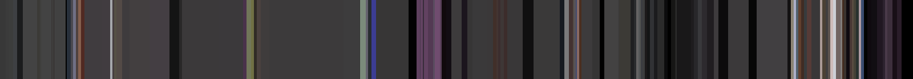
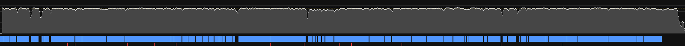

# Extraction · Le paradoxe de l’intelligence

> Généré automatiquement par `shared/outils/analyser-reference`. Données **mesurées** sur la vidéo.
> L'interprétation (DA, intentions) se fait dans `../../analyses/`.

## Source

| | |
|---|---|
| Lien | https://www.youtube.com/watch?v=CG2jTExMv88 |
| Chaîne | CroustiJu |
| Publiée le | 16/09/2026 |
| Durée | 17:14 |
| Résolution analysée | 1280×720 @ 60.00 i/s |
| Seuils de détection | 0.3 (franche) / 0.08 (adaptative) |
| Extrait le | 2026-11-05 |

## Rythme du montage

| Mesure | Valeur |
|---|---|
| Plans détectés | 180 |
| Durée moyenne d'un plan | 5.7 s |
| Médiane | 3.3 s |
| 10 % des plans durent moins de | 0.3 s |
| 10 % des plans durent plus de | 12.4 s |
| Coupes par minute (moyenne) | 10.4 |
| Transitions progressives (fondus, enchaînés…) | 11 sur 179 (6 %) |

> Les transitions progressives sont placées au milieu du fondu : la durée des plans qui les entourent est approximative (± 0,5 s).

### Coupes par minute, par tranche de 2 min

```
   00:00  █████████████████████████████·  17.5
   02:00  ████████······················  5.0
   04:00  ███████·······················  4.0
   06:00  ██████████····················  6.0
   08:00  ████████████████··············  9.5
   10:00  ██████████████················  8.5
   12:00  ███████████████████████·······  13.5
   14:00  ██████████████████████████████  18.0
   16:00  ██████████████████████········  12.9
```

### Les 10 plans les plus longs (moments contemplatifs)

| Plan | Début | Durée |
|---|---|---|
| P053 | 05:05.1 | 84.4 s |
| P045 | 03:26.5 | 41.8 s |
| P060 | 07:06.1 | 36.8 s |
| P130 | 14:17.0 | 35.1 s |
| P085 | 10:04.3 | 29.9 s |
| P046 | 04:08.3 | 27.1 s |
| P128 | 13:44.7 | 23.4 s |
| P042 | 02:49.2 | 22.8 s |
| P041 | 02:26.9 | 22.3 s |
| P034 | 01:35.9 | 19.2 s |

### Rafales de montage (≥ 6 coupes en 10 s)

| Début | Coupes en 10 s |
|---|---|
| 00:42.1 | 10 |
| 00:58.1 | 10 |
| 10:49.3 | 6 |
| 11:58.0 | 7 |
| 14:52.1 | 17 |

## Couleur


Palette dominante de la vidéo entière (k-means sur les vignettes, pondéré par la durée des plans) :

| Couleur | Part | Luminance | Saturation |
|---|---|---|---|
| `#343333` | 53.4 % | 20 % | 2 % |
| `#020102` | 15.5 % | 1 % | 39 % |
| `#534a4f` | 9.4 % | 30 % | 11 % |
| `#1f171b` | 7.7 % | 10 % | 24 % |
| `#706976` | 5.6 % | 42 % | 11 % |
| `#a194a1` | 3.9 % | 60 % | 8 % |
| `#d6c9d3` | 2.9 % | 80 % | 6 % |
| `#896e4b` | 1.6 % | 44 % | 45 % |

- Luminance moyenne : **22 %**
- Temps passé sur des plans très sombres (luminance < 15 %) : **19 %**
- Saturation moyenne : **10 %**

Évolution de la couleur dans le temps (chaque plan = sa couleur moyenne, largeur ∝ durée) :



## Son

> Mesures objectives de la bande sonore. Claude ne peut pas écouter : il lit ces mesures, les frises et la transcription.



*Sonie court terme sur toute la vidéo (ligne jaune pointillée = sonie intégrée), voix en bleu, événements marquants en rouge.*

### Niveau et dynamique

| Mesure | Valeur | Repère |
|---|---|---|
| Sonie intégrée | **-14.5 LUFS** | YouTube normalise à −14 LUFS (plus faible : ne sera pas monté) |
| Plage dynamique (LRA) | **2.9 LU** | < 5 : très compressé · 5-10 : typique YouTube · > 12 : cinéma, très nuancé |
| Crête vraie | -1.8 dBTP | ≤ −1 dBTP recommandé |

Sonie médiane par tranche de 2 min (où ça monte, où ça respire) :

```
   00:00  ███████████████████████·······  -14.9 LUFS
   02:00  ███████████████████████·······  -14.8 LUFS
   04:00  ███████████████████████·······  -15.0 LUFS
   06:00  ███████████████████████·······  -14.8 LUFS
   08:00  ███████████████████████·······  -15.2 LUFS
   10:00  ████████████████████████······  -14.5 LUFS
   12:00  ███████████████████████·······  -14.9 LUFS
   14:00  ████████████████████████······  -14.5 LUFS
   16:00  ███████████████████████·······  -15.7 LUFS
```

### Voix

Source : séparation IA (Demucs).

| Mesure | Valeur |
|---|---|
| Temps de parole | **90 %** de la vidéo |
| Voix au-dessus de l'accompagnement (médiane) | **23.7 dB** |
| Ducking (l'accompagnement baisse quand la voix parle) | **8.1 dB** (-39.0 dBFS sous la voix, -30.9 dBFS sans) |

**Respirations** (passages sans voix ≥ 2,5 s), les plus longues :

| Début | Durée | Ce que fait le son pendant ce temps |
|---|---|---|
| 00:43.2 | 4.0 s | son à -21 LUFS |
| 00:58.0 | 5.0 s | son à -25 LUFS |
| 05:55.1 | 4.7 s | son à -21 LUFS |
| 07:41.3 | 3.9 s | son à -21 LUFS |
| 12:35.6 | 3.5 s | son à -19 LUFS, 1 événement(s) |
| 12:59.1 | 4.9 s | son à -19 LUFS |
| 16:39.4 | 34.9 s | son à -16 LUFS |

### Silences

4 silence(s) ≥ 0,6 s (niveau < -49 dBFS) :

| Début | Durée |
|---|---|
| 09:51.1 | 1.2 s |
| 16:01.3 | 0.9 s |
| 17:06.6 | 2.5 s |
| 17:11.3 | 3.1 s |

### Musique et rythme

| Mesure | Valeur |
|---|---|
| Tempo dominant estimé | **120 BPM** |
| Part du temps avec une pulsation nette | 7 % |
| Attaques sonores (tous sons confondus) | 263 par minute |
| Coupes franches tombant sur une attaque sonore (± 70 ms) | **94 %** (hasard : 57 %) |

> Tempo : estimation automatique (une erreur d'un facteur 2 est possible). Synchronisation : nettement au-dessus du hasard = montage calé sur le son.

Tempo par tranche : 00:00 : 120 BPM · 02:00 : — · 04:00 : 150 BPM · 06:00 : 107 BPM · 08:00 : — · 10:00 : — · 12:00 : — · 14:00 : — · 16:00 : 88 BPM

### Événements sonores marquants

14 événements (0.8 par minute) : sons soudains et « bruités » (impacts, whooshes, chocs, souffles), hors pulsation musicale, détectés sur l'accompagnement (voix retirée).

| Timecode | Saut d'énergie | Niveau |
|---|---|---|
| 01:41.2 | +18 dB | -28 dBFS |
| 01:52.9 | +17 dB | -32 dBFS |
| 03:12.0 | +11 dB | -26 dBFS |
| 03:52.7 | +13 dB | -45 dBFS |
| 04:25.9 | +23 dB | -24 dBFS |
| 06:48.1 | +16 dB | -26 dBFS |
| 07:38.8 | +11 dB | -42 dBFS |
| 08:32.4 | +10 dB | -42 dBFS |
| 08:49.9 | +12 dB | -44 dBFS |
| 08:50.5 | +14 dB | -44 dBFS |
| 10:05.1 | +10 dB | -42 dBFS |
| 10:06.4 | +10 dB | -39 dBFS |
| 12:36.4 | +18 dB | -14 dBFS |
| 14:08.2 | +27 dB | -26 dBFS |

### Frises

De haut en bas : **sonie** (pointillé jaune = sonie intégrée) · **voix** (bleu) et **accompagnement** (orange, si séparation) · **spectrogramme** (grave en bas, aigu en haut ; la voix forme des bandes horizontales serrées, les impacts des traits verticaux) · **coupes** image (blanc = franche, gris = fondu) et **événements** (rouge) · temps.

| Frise | Tranche |
|---|---|
| [frise-001.jpg](frises/frise-001.jpg) | 00:00 → 02:00 |
| [frise-002.jpg](frises/frise-002.jpg) | 02:00 → 04:00 |
| [frise-003.jpg](frises/frise-003.jpg) | 04:00 → 06:00 |
| [frise-004.jpg](frises/frise-004.jpg) | 06:00 → 08:00 |
| [frise-005.jpg](frises/frise-005.jpg) | 08:00 → 10:00 |
| [frise-006.jpg](frises/frise-006.jpg) | 10:00 → 12:00 |
| [frise-007.jpg](frises/frise-007.jpg) | 12:00 → 14:00 |
| [frise-008.jpg](frises/frise-008.jpg) | 14:00 → 16:00 |
| [frise-009.jpg](frises/frise-009.jpg) | 16:00 → 17:14 |

Détail seconde par seconde : [`son.csv`](son.csv).


## Planches contact

281 vignettes pour 180 plans : une par plan, plus une toutes les ~5 s dans les plans longs (notées `2/3`…), pour voir le mouvement.
Étiquette de chaque vignette : `numéro de plan · timecode de l'image · (durée du plan)`.

| Planche | Vignettes |
|---|---|
| [planche-001.jpg](planches/planche-001.jpg) | 00:02 → 00:46 |
| [planche-002.jpg](planches/planche-002.jpg) | 00:47 → 01:24 |
| [planche-003.jpg](planches/planche-003.jpg) | 01:27 → 02:46 |
| [planche-004.jpg](planches/planche-004.jpg) | 02:52 → 04:46 |
| [planche-005.jpg](planches/planche-005.jpg) | 04:49 → 07:11 |
| [planche-006.jpg](planches/planche-006.jpg) | 07:20 → 08:30 |
| [planche-007.jpg](planches/planche-007.jpg) | 08:33 → 09:41 |
| [planche-008.jpg](planches/planche-008.jpg) | 09:46 → 11:01 |
| [planche-009.jpg](planches/planche-009.jpg) | 11:05 → 12:05 |
| [planche-010.jpg](planches/planche-010.jpg) | 12:07 → 13:08 |
| [planche-011.jpg](planches/planche-011.jpg) | 13:13 → 14:39 |
| [planche-012.jpg](planches/planche-012.jpg) | 14:48 → 15:09 |
| [planche-013.jpg](planches/planche-013.jpg) | 15:13 → 16:08 |
| [planche-014.jpg](planches/planche-014.jpg) | 16:11 → 17:08 |
| [planche-015.jpg](planches/planche-015.jpg) | 17:12 → 17:12 |

Détail plan par plan : [`plans.csv`](plans.csv).

## Fichiers hors Git (sur la machine qui a lancé l'extraction)

- Vidéo et métadonnées : `.cache/references/cg2jtexmv88/`
