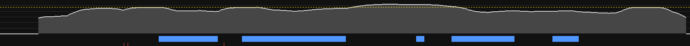

# Extraction · sintel_trailer-480p

> Généré automatiquement par `shared/outils/analyser-reference`. Données **mesurées** sur la vidéo.
> L'interprétation (DA, intentions) se fait dans `../../analyses/`.

## Source

| | |
|---|---|
| Lien | https://download.blender.org/durian/trailer/sintel_trailer-480p.mp4 |
| Publiée le | 12/05/2010 |
| Durée | 00:52 |
| Résolution analysée | 854×480 @ 24.00 i/s |
| Seuils de détection | 0.3 (franche) / 0.08 (adaptative) |
| Extrait le | 2026-11-05 |

## Rythme du montage

| Mesure | Valeur |
|---|---|
| Plans détectés | 18 |
| Durée moyenne d'un plan | 2.9 s |
| Médiane | 2.5 s |
| 10 % des plans durent moins de | 1.0 s |
| 10 % des plans durent plus de | 5.2 s |
| Coupes par minute (moyenne) | 20.7 |
| Transitions progressives (fondus, enchaînés…) | 8 sur 17 (47 %) |

> Les transitions progressives sont placées au milieu du fondu : la durée des plans qui les entourent est approximative (± 0,5 s).

### Coupes par minute, par tranche de 1 min

```
   00:00  ██████████████████████████████  20.7
```

### Les 10 plans les plus longs (moments contemplatifs)

| Plan | Début | Durée |
|---|---|---|
| P016 | 00:41.5 | 7.0 s |
| P015 | 00:34.8 | 6.8 s |
| P013 | 00:28.0 | 4.5 s |
| P003 | 00:04.5 | 4.3 s |
| P008 | 00:17.5 | 3.5 s |
| P004 | 00:08.8 | 3.5 s |
| P002 | 00:01.0 | 3.5 s |
| P009 | 00:21.0 | 2.8 s |
| P006 | 00:13.9 | 2.6 s |
| P017 | 00:48.5 | 2.4 s |

## Couleur


Palette dominante de la vidéo entière (k-means sur les vignettes, pondéré par la durée des plans) :

| Couleur | Part | Luminance | Saturation |
|---|---|---|---|
| `#020202` | 49.2 % | 1 % | 30 % |
| `#271e17` | 14.5 % | 12 % | 41 % |
| `#4d4137` | 10.2 % | 26 % | 28 % |
| `#90613c` | 6.9 % | 41 % | 58 % |
| `#7c7c7a` | 5.6 % | 49 % | 2 % |
| `#9fa19f` | 5.5 % | 63 % | 1 % |
| `#c2885b` | 5.2 % | 57 % | 53 % |
| `#e9bf89` | 3.0 % | 77 % | 41 % |

- Luminance moyenne : **19 %**
- Temps passé sur des plans très sombres (luminance < 15 %) : **49 %**
- Saturation moyenne : **25 %**

Évolution de la couleur dans le temps (chaque plan = sa couleur moyenne, largeur ∝ durée) :


## Son

> Mesures objectives de la bande sonore. Claude ne peut pas écouter : il lit ces mesures, les frises et la transcription.



*Sonie court terme sur toute la vidéo (ligne jaune pointillée = sonie intégrée), voix en bleu, événements marquants en rouge.*

### Niveau et dynamique

| Mesure | Valeur | Repère |
|---|---|---|
| Sonie intégrée | **-12.8 LUFS** | YouTube normalise à −14 LUFS (plus fort : sera baissé) |
| Plage dynamique (LRA) | **14.6 LU** | < 5 : très compressé · 5-10 : typique YouTube · > 12 : cinéma, très nuancé |
| Crête vraie | 1.2 dBTP | ≤ −1 dBTP recommandé |

Sonie médiane par tranche de 1 min (où ça monte, où ça respire) :

```
   00:00  ███████████████████████·······  -16.2 LUFS
```

### Voix

Source : séparation IA (Demucs).

| Mesure | Valeur |
|---|---|
| Temps de parole | **38 %** de la vidéo |
| Voix au-dessus de l'accompagnement (médiane) | **5.2 dB** |
| Ducking (l'accompagnement baisse quand la voix parle) | **11.2 dB** (-28.4 dBFS sous la voix, -17.2 dBFS sans) |

**Respirations** (passages sans voix ≥ 2,5 s), les plus longues :

| Début | Durée | Ce que fait le son pendant ce temps |
|---|---|---|
| 00:00.0 | 12.0 s | son à -15 LUFS, 2 événement(s) |
| 00:26.2 | 5.3 s | son à -8 LUFS |
| 00:38.9 | 2.9 s | son à -19 LUFS |
| 00:43.8 | 8.4 s | son à -20 LUFS |

### Silences

2 silence(s) ≥ 0,6 s (niveau < -53 dBFS) :

| Début | Durée |
|---|---|
| 00:00.0 | 1.2 s |
| 00:51.3 | 0.7 s |

### Musique et rythme

| Mesure | Valeur |
|---|---|
| Tempo dominant estimé | **143 BPM** |
| Part du temps avec une pulsation nette | 43 % |
| Attaques sonores (tous sons confondus) | 117 par minute |
| Coupes franches tombant sur une attaque sonore (± 70 ms) | **33 %** (hasard : 27 %) |

> Tempo : estimation automatique (une erreur d'un facteur 2 est possible). Synchronisation : nettement au-dessus du hasard = montage calé sur le son.

### Événements sonores marquants

3 événements (3.4 par minute) : sons soudains et « bruités » (impacts, whooshes, chocs, souffles), hors pulsation musicale, détectés sur l'accompagnement (voix retirée).

| Timecode | Saut d'énergie | Niveau |
|---|---|---|
| 00:09.4 | +20 dB | -5 dBFS |
| 00:09.7 | +15 dB | -8 dBFS |
| 00:16.9 | +11 dB | -5 dBFS |

### Frises

De haut en bas : **sonie** (pointillé jaune = sonie intégrée) · **voix** (bleu) et **accompagnement** (orange, si séparation) · **spectrogramme** (grave en bas, aigu en haut ; la voix forme des bandes horizontales serrées, les impacts des traits verticaux) · **coupes** image (blanc = franche, gris = fondu) et **événements** (rouge) · temps.

| Frise | Tranche |
|---|---|
| [frise-001.jpg](frises/frise-001.jpg) | 00:00 → 00:52 |

Détail seconde par seconde : [`son.csv`](son.csv).


## Planches contact

20 vignettes pour 18 plans : une par plan, plus une toutes les ~5 s dans les plans longs (notées `2/3`…), pour voir le mouvement.
Étiquette de chaque vignette : `numéro de plan · timecode de l'image · (durée du plan)`.

| Planche | Vignettes |
|---|---|
| [planche-001.jpg](planches/planche-001.jpg) | 00:01 → 00:52 |

Détail plan par plan : [`plans.csv`](plans.csv).

## Fichiers hors Git (sur la machine qui a lancé l'extraction)

- Vidéo et métadonnées : `.cache/references/exemple-sintel-bande-annonce/`
