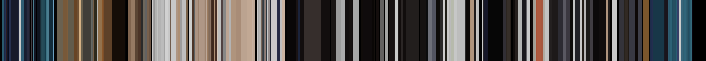
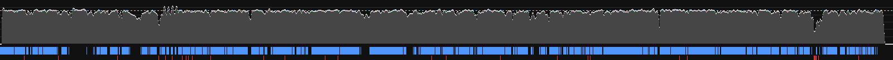

# Extraction · Le Vertige Infini de la Bibliothèque de Babel

> Généré automatiquement par `shared/outils/analyser-reference`. Données **mesurées** sur la vidéo.
> L'interprétation (DA, intentions) se fait dans `../../analyses/`.

## Source

| | |
|---|---|
| Lien | https://www.youtube.com/watch?v=J3JsyxABi0g |
| Chaîne | ASTRE |
| Publiée le | 28/08/2026 |
| Durée | 25:41 |
| Résolution analysée | 1280×720 @ 25.00 i/s |
| Seuils de détection | 0.3 (franche) / 0.08 (adaptative) |
| Extrait le | 2026-11-05 |

## Rythme du montage

| Mesure | Valeur |
|---|---|
| Plans détectés | 407 |
| Durée moyenne d'un plan | 3.8 s |
| Médiane | 2.0 s |
| 10 % des plans durent moins de | 0.4 s |
| 10 % des plans durent plus de | 8.4 s |
| Coupes par minute (moyenne) | 15.8 |
| Transitions progressives (fondus, enchaînés…) | 4 sur 406 (1 %) |

> Les transitions progressives sont placées au milieu du fondu : la durée des plans qui les entourent est approximative (± 0,5 s).

### Coupes par minute, par tranche de 2 min

```
   00:00  █████████████████████████████·  28.0
   02:00  █████████████·················  12.5
   04:00  ███████████████████···········  18.5
   06:00  ████████████████████████······  22.5
   08:00  █████████████████·············  16.5
   10:00  ███████████···················  10.5
   12:00  ██████████████················  13.0
   14:00  ████████······················  7.5
   16:00  ██████████████················  13.5
   18:00  ████████████████··············  15.5
   20:00  ████████······················  7.5
   22:00  ███████████████···············  14.0
   24:00  ██████████████████████████████  28.6
```

### Les 10 plans les plus longs (moments contemplatifs)

| Plan | Début | Durée |
|---|---|---|
| P216 | 11:02.9 | 37.2 s |
| P082 | 04:04.8 | 28.6 s |
| P407 | 25:12.8 | 28.0 s |
| P252 | 14:46.1 | 27.4 s |
| P359 | 23:44.4 | 25.0 s |
| P285 | 17:45.8 | 24.3 s |
| P217 | 11:40.1 | 21.0 s |
| P235 | 13:12.3 | 19.1 s |
| P212 | 10:26.1 | 18.7 s |
| P081 | 03:47.4 | 17.4 s |

### Rafales de montage (≥ 6 coupes en 10 s)

| Début | Coupes en 10 s |
|---|---|
| 00:08.1 | 9 |
| 01:27.0 | 14 |
| 05:24.6 | 8 |
| 05:37.4 | 12 |
| 07:33.8 | 10 |
| 10:04.3 | 11 |
| 23:35.9 | 9 |
| 24:20.6 | 13 |
| 24:52.1 | 13 |
| 25:03.8 | 9 |

## Couleur


Palette dominante de la vidéo entière (k-means sur les vignettes, pondéré par la durée des plans) :

| Couleur | Part | Luminance | Saturation |
|---|---|---|---|
| `#070606` | 33.0 % | 2 % | 24 % |
| `#1e2027` | 16.3 % | 12 % | 24 % |
| `#bcb9b5` | 10.1 % | 73 % | 4 % |
| `#9c948c` | 9.4 % | 59 % | 11 % |
| `#554133` | 8.7 % | 27 % | 40 % |
| `#e2e1df` | 8.5 % | 88 % | 1 % |
| `#876b55` | 8.2 % | 44 % | 37 % |
| `#35576b` | 5.9 % | 32 % | 50 % |

- Luminance moyenne : **31 %**
- Temps passé sur des plans très sombres (luminance < 15 %) : **38 %**
- Saturation moyenne : **24 %**

Évolution de la couleur dans le temps (chaque plan = sa couleur moyenne, largeur ∝ durée) :



## Son

> Mesures objectives de la bande sonore. Claude ne peut pas écouter : il lit ces mesures, les frises et la transcription.



*Sonie court terme sur toute la vidéo (ligne jaune pointillée = sonie intégrée), voix en bleu, événements marquants en rouge.*

### Niveau et dynamique

| Mesure | Valeur | Repère |
|---|---|---|
| Sonie intégrée | **-14.1 LUFS** | YouTube normalise à −14 LUFS (plus faible : ne sera pas monté) |
| Plage dynamique (LRA) | **6.1 LU** | < 5 : très compressé · 5-10 : typique YouTube · > 12 : cinéma, très nuancé |
| Crête vraie | 0.7 dBTP | ≤ −1 dBTP recommandé |

Sonie médiane par tranche de 2 min (où ça monte, où ça respire) :

```
   00:00  ████████████████████████······  -14.1 LUFS
   02:00  ███████████████████████·······  -15.5 LUFS
   04:00  ███████████████████████·······  -15.3 LUFS
   06:00  ████████████████████████······  -14.6 LUFS
   08:00  ████████████████████████······  -14.4 LUFS
   10:00  ███████████████████████·······  -15.1 LUFS
   12:00  ███████████████████████·······  -15.1 LUFS
   14:00  ███████████████████████·······  -15.4 LUFS
   16:00  ███████████████████████·······  -15.3 LUFS
   18:00  ████████████████████████······  -13.8 LUFS
   20:00  ████████████████████████······  -14.4 LUFS
   22:00  ███████████████████████·······  -15.5 LUFS
   24:00  ███████████████████████·······  -15.4 LUFS
```

### Voix

Source : séparation IA (Demucs).

| Mesure | Valeur |
|---|---|
| Temps de parole | **78 %** de la vidéo |
| Voix au-dessus de l'accompagnement (médiane) | **17.7 dB** |
| Ducking (l'accompagnement baisse quand la voix parle) | **7.6 dB** (-33.1 dBFS sous la voix, -25.6 dBFS sans) |

**Respirations** (passages sans voix ≥ 2,5 s), les plus longues :

| Début | Durée | Ce que fait le son pendant ce temps |
|---|---|---|
| 01:40.5 | 5.4 s | son à -18 LUFS |
| 01:59.5 | 29.9 s | son à -13 LUFS |
| 02:29.9 | 11.3 s | son à -17 LUFS |
| 03:05.0 | 4.6 s | son à -19 LUFS |
| 03:44.4 | 17.9 s | son à -22 LUFS |
| 04:30.5 | 4.8 s | son à -24 LUFS, 1 événement(s) |
| 07:07.5 | 5.3 s | son à -23 LUFS |
| 07:41.4 | 5.4 s | son à -13 LUFS |
| 08:51.3 | 6.1 s | son à -16 LUFS |
| 10:22.5 | 15.4 s | son à -20 LUFS |
| 11:40.7 | 11.5 s | son à -18 LUFS |
| 15:19.9 | 10.0 s | son à -19 LUFS |
| 23:21.1 | 6.3 s | son à -40 LUFS, 4 événement(s) |
| 24:04.7 | 4.4 s | son à -19 LUFS |
| 25:14.1 | 26.6 s | son à -16 LUFS |

### Silences

3 silence(s) ≥ 0,6 s (niveau < -49 dBFS) :

| Début | Durée |
|---|---|
| 04:33.8 | 0.9 s |
| 04:35.8 | 0.7 s |
| 25:23.8 | 16.9 s |

### Musique et rythme

| Mesure | Valeur |
|---|---|
| Tempo dominant estimé | **123 BPM** |
| Part du temps avec une pulsation nette | 13 % |
| Attaques sonores (tous sons confondus) | 215 par minute |
| Coupes franches tombant sur une attaque sonore (± 70 ms) | **61 %** (hasard : 47 %) |

> Tempo : estimation automatique (une erreur d'un facteur 2 est possible). Synchronisation : nettement au-dessus du hasard = montage calé sur le son.

Tempo par tranche : 00:00 : — · 02:00 : — · 04:00 : 77 BPM · 06:00 : 130 BPM · 08:00 : 150 BPM · 10:00 : 187 BPM · 12:00 : 158 BPM · 14:00 : 65 BPM · 16:00 : — · 18:00 : — · 20:00 : 60 BPM · 22:00 : 81 BPM · 24:00 : 97 BPM

### Événements sonores marquants

31 événements (1.2 par minute) : sons soudains et « bruités » (impacts, whooshes, chocs, souffles), hors pulsation musicale, détectés sur l'accompagnement (voix retirée).

| Timecode | Saut d'énergie | Niveau |
|---|---|---|
| 00:41.7 | +21 dB | -12 dBFS |
| 04:33.1 | +20 dB | -29 dBFS |
| 04:57.1 | +16 dB | -16 dBFS |
| 05:13.6 | +22 dB | -20 dBFS |
| 05:20.6 | +16 dB | -30 dBFS |
| 05:31.5 | +14 dB | -28 dBFS |
| 06:02.9 | +15 dB | -23 dBFS |
| 07:35.0 | +14 dB | -12 dBFS |
| 09:43.0 | +22 dB | -28 dBFS |
| 12:24.8 | +20 dB | -25 dBFS |
| 12:49.1 | +14 dB | -39 dBFS |
| 14:23.1 | +13 dB | -26 dBFS |
| 19:45.1 | +18 dB | -22 dBFS |
| 23:24.4 | +19 dB | -36 dBFS |
| 23:24.5 | +13 dB | -38 dBFS |
| 23:25.2 | +26 dB | -34 dBFS |
| 23:26.6 | +26 dB | -34 dBFS |
| 23:27.4 | +15 dB | -39 dBFS |
| 23:32.1 | +25 dB | -35 dBFS |
| 24:40.7 | +16 dB | -10 dBFS |

### Frises

De haut en bas : **sonie** (pointillé jaune = sonie intégrée) · **voix** (bleu) et **accompagnement** (orange, si séparation) · **spectrogramme** (grave en bas, aigu en haut ; la voix forme des bandes horizontales serrées, les impacts des traits verticaux) · **coupes** image (blanc = franche, gris = fondu) et **événements** (rouge) · temps.

| Frise | Tranche |
|---|---|
| [frise-001.jpg](frises/frise-001.jpg) | 00:00 → 02:00 |
| [frise-002.jpg](frises/frise-002.jpg) | 02:00 → 04:00 |
| [frise-003.jpg](frises/frise-003.jpg) | 04:00 → 06:00 |
| [frise-004.jpg](frises/frise-004.jpg) | 06:00 → 08:00 |
| [frise-005.jpg](frises/frise-005.jpg) | 08:00 → 10:00 |
| [frise-006.jpg](frises/frise-006.jpg) | 10:00 → 12:00 |
| [frise-007.jpg](frises/frise-007.jpg) | 12:00 → 14:00 |
| [frise-008.jpg](frises/frise-008.jpg) | 14:00 → 16:00 |
| [frise-009.jpg](frises/frise-009.jpg) | 16:00 → 18:00 |
| [frise-010.jpg](frises/frise-010.jpg) | 18:00 → 20:00 |
| [frise-011.jpg](frises/frise-011.jpg) | 20:00 → 22:00 |
| [frise-012.jpg](frises/frise-012.jpg) | 22:00 → 24:00 |
| [frise-013.jpg](frises/frise-013.jpg) | 24:00 → 25:41 |

Détail seconde par seconde : [`son.csv`](son.csv).


## Planches contact

551 vignettes pour 407 plans : une par plan, plus une toutes les ~5 s dans les plans longs (notées `2/3`…), pour voir le mouvement.
Étiquette de chaque vignette : `numéro de plan · timecode de l'image · (durée du plan)`.

| Planche | Vignettes |
|---|---|
| [planche-001.jpg](planches/planche-001.jpg) | 00:02 → 00:40 |
| [planche-002.jpg](planches/planche-002.jpg) | 00:44 → 01:27 |
| [planche-003.jpg](planches/planche-003.jpg) | 01:28 → 01:51 |
| [planche-004.jpg](planches/planche-004.jpg) | 01:55 → 02:58 |
| [planche-005.jpg](planches/planche-005.jpg) | 03:01 → 03:50 |
| [planche-006.jpg](planches/planche-006.jpg) | 03:54 → 05:06 |
| [planche-007.jpg](planches/planche-007.jpg) | 05:08 → 05:46 |
| [planche-008.jpg](planches/planche-008.jpg) | 05:46 → 06:36 |
| [planche-009.jpg](planches/planche-009.jpg) | 06:39 → 07:30 |
| [planche-010.jpg](planches/planche-010.jpg) | 07:32 → 08:06 |
| [planche-011.jpg](planches/planche-011.jpg) | 08:09 → 09:15 |
| [planche-012.jpg](planches/planche-012.jpg) | 09:16 → 09:51 |
| [planche-013.jpg](planches/planche-013.jpg) | 09:54 → 10:28 |
| [planche-014.jpg](planches/planche-014.jpg) | 10:33 → 12:14 |
| [planche-015.jpg](planches/planche-015.jpg) | 12:17 → 13:02 |
| [planche-016.jpg](planches/planche-016.jpg) | 13:05 → 14:11 |
| [planche-017.jpg](planches/planche-017.jpg) | 14:15 → 15:35 |
| [planche-018.jpg](planches/planche-018.jpg) | 15:40 → 16:38 |
| [planche-019.jpg](planches/planche-019.jpg) | 16:40 → 17:40 |
| [planche-020.jpg](planches/planche-020.jpg) | 17:44 → 18:41 |
| [planche-021.jpg](planches/planche-021.jpg) | 18:45 → 19:47 |
| [planche-022.jpg](planches/planche-022.jpg) | 19:49 → 21:00 |
| [planche-023.jpg](planches/planche-023.jpg) | 21:04 → 22:18 |
| [planche-024.jpg](planches/planche-024.jpg) | 22:22 → 23:12 |
| [planche-025.jpg](planches/planche-025.jpg) | 23:15 → 24:12 |
| [planche-026.jpg](planches/planche-026.jpg) | 24:15 → 24:36 |
| [planche-027.jpg](planches/planche-027.jpg) | 24:37 → 25:04 |
| [planche-028.jpg](planches/planche-028.jpg) | 25:05 → 25:37 |

Détail plan par plan : [`plans.csv`](plans.csv).

## Fichiers hors Git (sur la machine qui a lancé l'extraction)

- Vidéo et métadonnées : `.cache/references/j3jsyxabi0g/`
